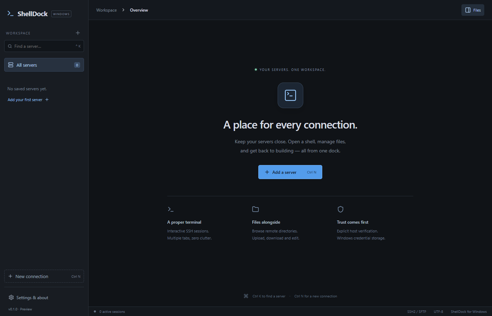

# ShellDock for Windows

[ShellDock macOS](https://github.com/HarunBulbull/ShellDock) projesinin Rust + Tauri 2 + React ile geliştirilen Windows uyarlaması.

[](https://github.com/HarunBulbull/ShellDock-Rust/actions/workflows/windows.yml)
[](LICENSE)

SSH oturumlarını ve uzak dosyaları tek çalışma alanında yönetin. Sunucularınızı kaydedin, birden fazla terminal sekmesi açın ve SFTP panelinde dosya aktarın.

**v0.1.0 bir geliştirme önizlemesidir.** İlk SSH/SFTP iş akışları kullanılabilir; macOS sürümüyle tam özellik eşitliği henüz sağlanmadı. [Eksikler ve yol haritası](docs/PARITY.md).

## Windows için indir

| Paket | İndirme |
|---|---|
| Windows x64 kurulum dosyası | [ShellDock_0.1.0_x64-setup.exe](https://github.com/HarunBulbull/ShellDock-Rust/releases/download/v0.1.0/ShellDock_0.1.0_x64-setup.exe) |
| Taşınabilir paket — uygulama ve lisanslar | [ShellDock_0.1.0_windows-x64.zip](https://github.com/HarunBulbull/ShellDock-Rust/releases/download/v0.1.0/ShellDock_0.1.0_windows-x64.zip) |
| Doğrudan çalıştırılabilir uygulama | [ShellDock_0.1.0_windows-x64.exe](https://github.com/HarunBulbull/ShellDock-Rust/releases/download/v0.1.0/ShellDock_0.1.0_windows-x64.exe) |
| SHA-256 doğrulama değerleri | [SHA256SUMS.txt](https://github.com/HarunBulbull/ShellDock-Rust/releases/download/v0.1.0/SHA256SUMS.txt) |

[Sürüm notları ve tüm dosyalar](https://github.com/HarunBulbull/ShellDock-Rust/releases/tag/v0.1.0)

Windows 10/11 x64 ve Microsoft Edge WebView2 Runtime gerekir. Hazır paketleri kullanmak için Rust, Node.js, Perl veya Visual Studio kurmanız gerekmez. Taşınabilir ZIP'i bir klasöre çıkarıp `ShellDock.exe` dosyasını açabilirsiniz.

Dosyalar kod imzalı değildir. Bu önizlemede aktarım hatasında kısmi hedef dosya kalabilir ve uzak metin düzenleyicisi atomik kayıt yapmaz. Kurulum/kaldırma sihirbazı ayrıca uçtan uca test edilmedi.



Gerçek `.exe` açılışı, WebView2 arayüzü ve Rust IPC otomatik testten geçti. Test kapsamı ve ilk derlemenin doğrulama değerleri: [Windows doğrulama kaydı](docs/VALIDATION.md).

## Kaynaktan geliştirme

Gerekenler: Windows 10/11 x64, Node.js 22 veya üzeri, Rust MSVC stable, Visual Studio 2022 Build Tools içindeki **Desktop development with C++** bileşenleri ve WebView2 Runtime.

Eksik C++ araçlarını PowerShell'den kurabilirsiniz; Windows yönetici onayını kullanıcının vermesi gerekir:

```powershell
winget install --id Microsoft.VisualStudio.2022.BuildTools -e --accept-package-agreements --accept-source-agreements --override "--wait --quiet --norestart --add Microsoft.VisualStudio.Workload.VCTools --includeRecommended"
```

Kurulumdan sonra terminali yeniden açın ve proje klasöründe:

```powershell
git clone https://github.com/HarunBulbull/ShellDock-Rust.git
cd ShellDock-Rust
npm.cmd ci
npm.cmd run setup:perl
npm.cmd run desktop
```

Alternatif olarak **Start.cmd** dosyasını çalıştırın. Bu dosya Rust PATH'ini mevcut işlem için ekler, eksik npm bağımlılıklarını yükler ve geliştirme uygulamasını başlatır. npm komutları proje içindeki taşınabilir Perl'i veya `C:/Strawberry/perl/bin/perl.exe` dosyasını otomatik bulur. Perl yalnızca OpenSSL'i derlemek için gerekir; uygulamanın çalışması için gerekmez. İlk kaynak derlemesi birkaç dakika sürebilir.

Yalnızca tarayıcı arayüzünü görmek için:

```powershell
npm.cmd run dev
```

Adres: `http://127.0.0.1:1420`. Tarayıcı önizlemesi SSH bağlantısı kuramaz ve sunucu kayıtlarını diske yazamaz. Gerçek işlemler masaüstü uygulamasındaki Rust komutlarıyla çalışır.

## İlk sürüme eklenenler

- Sunucu oluşturma, düzenleme, silme; grup, favori, not ve arama.
- Bağımsız SSH sekmeleri; xterm.js, UTF-8, PTY boyutlandırma ve terminal araması (`Ctrl+F`).
- Parola, özel anahtar ve SSH agent kimlik doğrulama yolları.
- SHA-256 host anahtarı karşılaştırması; bilinmeyen/değişen anahtarlarda açık kullanıcı kararı.
- İsteğe bağlı Windows Credential Manager parola ve anahtar parolası saklama.
- SFTP gezinme, klasör oluşturma, yeniden adlandırma, dosya/boş klasör silme.
- Tek dosya yükleme/indirme ve byte ilerlemesi. Mevcut hedefler korunur; üzerine yazma arayüzü henüz yok.
- 2 MB'a kadar UTF-8 uzak dosya düzenleme.

Loopback protokol testleri Windows üzerinde parola, şifreli RSA anahtarı, OpenSSH Ed25519 özel anahtarı, Ed25519 host anahtarı, PTY ve SFTP işlemlerini doğrular. Bu testler gerçek üretim sunucusu, MFA, uzun oturum veya Windows SSH agent uyumluluğu garantisi vermez.

## Test ve paketleme

```powershell
npm.cmd run build
npx.cmd playwright install chromium
npm.cmd test
npm.cmd run test:rust
npm.cmd run tauri build
npm.cmd run test:desktop
```

- TypeScript/Vite üretim derlemesi ve iki Playwright testi yerelde geçti.
- Playwright gerçek Chromium kullanır; masaüstü IPC'sini taklit ederek sekme, host güven kararı, bağlantı durumu ve SFTP arayüzünü denetler. Bu, gerçek SSH taşıma testi değildir.
- Altı Rust testi Windows üzerinde geçti: bağlantı doğrulama, kalıcılık, credential saklama/okuma/silme ve geçici loopback sunucusuyla gerçek SSH/SFTP protokol testi dahil.
- Clippy `--all-targets -- -D warnings` kontrolü geçti.
- Gerçek Windows `.exe` dosyasında WebView2 açılışı, Rust IPC ve bağlantı formu kontrolü geçti. `test:desktop` yalnızca test işlemi için loopback debug portu açar; uygulama kapatılınca port kapanır. Bu kontrol sunucu kaydı oluşturmaz.
- Test sunucusu yalnızca `127.0.0.1` üzerinde rastgele portta, geçici RSA/Ed25519 anahtarları ve bellekte dosyalarla çalışır; gerçek sunucu olarak kullanılmaz.
- [Windows CI](https://github.com/HarunBulbull/ShellDock-Rust/actions/workflows/windows.yml); Rust testleri, Clippy, arayüz/masaüstü testleri ve NSIS paketlemesini çalıştırır. Güncel sonuçlar yukarıdaki durum rozetinde görülebilir.

Başarılı paketleme sonrasında kurulum dosyası `src-tauri/target/release/bundle/nsis/` altında oluşur. Kod imzalama yapılandırılmadı.

## Sınırlar ve sonraki işler

Klasör transferleri, transfer kuyruğu/duraklatma/devam, senkronizasyon, SHA-256 dosya doğrulama, sunucular arası kopya, yerel dosya paneli, sürükle-bırak, oturum restorasyonu ve Windows Explorer entegrasyonu henüz eklenmedi. Ayrıntılı karşılaştırma: [özellik eşitliği planı](docs/PARITY.md).

Aktarım hatasında kısmi hedef dosya kalabilir. Düzenleyici kaydı mevcut dosyayı değiştirir; uzak değişiklik çatışmalarını algılamaz ve atomik değildir. SFTP işlemleri şu anda her işlem için ayrı, anahtarı yeniden doğrulanan bağlantı açar; MFA/keyboard-interactive desteği yoktur.

## Kod yapısı

- `src/App.tsx`: bağlantılar, sekmeler ve ana çalışma alanı.
- `src/TerminalPane.tsx`: terminal yaşam döngüsü ve host anahtarı diyaloğu.
- `src/FilesPane.tsx`: SFTP paneli, transfer ilerlemesi ve düzenleyici.
- `src-tauri/src/lib.rs`: Rust bağlantı, güven, kimlik bilgileri ve SFTP işlemleri.
- `src-tauri/capabilities/default.json`: Tauri yetenekleri.
- `scripts/test-server.cjs`: yalıtılmış test sunucusu.
- `scripts/smoke-desktop.cjs`: gerçek WebView2 penceresi ve Rust IPC açılış kontrolü.
- `scripts/setup-perl.ps1`: SHA-256 doğrulamalı, proje içine taşınabilir Perl kurulumu.
- `docs/ARCHITECTURE.md`: teknik kararlar ve geliştirme yol haritası.

Bağlantı metaverisi ve güvenilen anahtarlar Tauri uygulama veri dizinindeki `workspace.json` içinde saklanır. Parolalar bu JSON'a yazılmaz. Oturum açıkken SFTP yeniden kimlik doğrulaması için parola Rust belleğinde tutulur ve son referans bırakıldığında `zeroize` ile temizlenir.

## Kaynaklar ve lisans

Araştırmada [orijinal ShellDock](https://github.com/HarunBulbull/ShellDock), [Tauri Windows gereksinimleri](https://v2.tauri.app/start/prerequisites/), [Windows paketleme](https://v2.tauri.app/distribute/windows-installer/), [ssh2 Rust API](https://docs.rs/ssh2/0.9.7/ssh2/) ve [keyring API](https://docs.rs/keyring/3.6.3/keyring/) esas alındı.

MIT. Uygulama simgesi orijinal ShellDock deposundan alınmıştır. Bağımlılık notları: [THIRD_PARTY_NOTICES.md](THIRD_PARTY_NOTICES.md).
