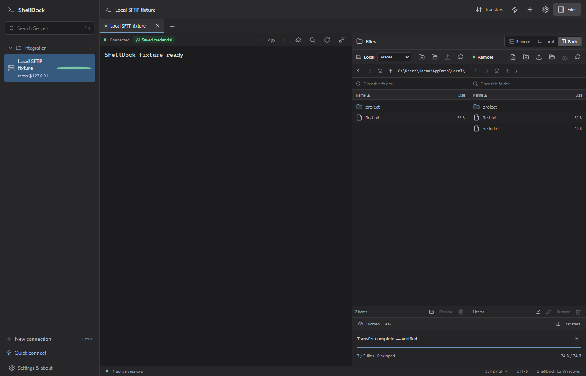

# ShellDock for Windows

[ShellDock macOS](https://github.com/HarunBulbull/ShellDock) projesinin Rust + Tauri 2 + React ile geliştirilen Windows uyarlaması.

[](https://github.com/HarunBulbull/ShellDock-Rust/actions/workflows/windows.yml)
[](LICENSE)

Sunucularınızı, SSH oturumlarınızı ve yerel/uzak dosyalarınızı tek çalışma alanında yönetin. Orijinal ShellDock düzenindeki sunucu listesi, terminal ve Remote / Local / Both dosya panelleri Windows için uyarlandı.

**v0.2.3 bir geliştirme önizlemesidir.** Kayıtlı şifreyle tek tıkla/çift tıklamayla otomatik bağlanma, çift yönlü sürükle-bırak, sınırsız/asenkron Windows Masaüstü/Explorer dışa sürükleme, MobaXterm tarzı indirmeden uzaktan dosya düzenleme ve özyinelemeli toplu uzak silme içerir; macOS sürümüyle tam özellik eşitliği henüz sağlanmadı. [Eksikler ve yol haritası](docs/PARITY.md).

## Windows için indir

| Paket                                     | İndirme                                                                                                                                    |
| ----------------------------------------- | ------------------------------------------------------------------------------------------------------------------------------------------ |
| Windows x64 kurulum dosyası               | [ShellDock_0.2.3_x64-setup.exe](https://github.com/HarunBulbull/ShellDock-Rust/releases/download/v0.2.3/ShellDock_0.2.3_x64-setup.exe)     |
| Taşınabilir paket — uygulama ve lisanslar | [ShellDock_0.2.3_windows-x64.zip](https://github.com/HarunBulbull/ShellDock-Rust/releases/download/v0.2.3/ShellDock_0.2.3_windows-x64.zip) |
| Doğrudan çalıştırılabilir uygulama        | [ShellDock_0.2.3_windows-x64.exe](https://github.com/HarunBulbull/ShellDock-Rust/releases/download/v0.2.3/ShellDock_0.2.3_windows-x64.exe) |
| SHA-256 doğrulama değerleri               | [SHA256SUMS.txt](https://github.com/HarunBulbull/ShellDock-Rust/releases/download/v0.2.3/SHA256SUMS.txt)                                   |

[Sürüm notları ve tüm dosyalar](https://github.com/HarunBulbull/ShellDock-Rust/releases/tag/v0.2.3)

Windows 10/11 x64 ve Microsoft Edge WebView2 Runtime gerekir. Hazır paketleri kullanmak için Rust, Node.js, Perl veya Visual Studio kurmanız gerekmez. Taşınabilir ZIP'i bir klasöre çıkarıp `ShellDock.exe` dosyasını açabilirsiniz.

Dosyalar kod imzalı değildir. Dosya transferleri geçici hedef kullanır; değiştirme başarısız olursa eski dosya geri yüklenmeye çalışılır. Uzak metin düzenleyicisi sunucu `mtime` çakışmasını denetler ve `.part` yedeklemesiyle kayıt yapar. Kurulum/kaldırma sihirbazı ayrıca uçtan uca test edilmedi.



Gerçek WebView2 dosya yöneticisi, SFTP havuzu ve uzaktan editör akışı yalıtılmış profilde otomatik testten geçti. Test kapsamı ve sınırlar: [v0.2.3 doğrulama kaydı](docs/VALIDATION_v0.2.3.md).

## Kaynaktan geliştirme

Gerekenler: Windows 10/11 x64, Node.js 22 veya üzeri, Rust MSVC stable, Visual Studio 2022 Build Tools içindeki **Desktop development with C++** bileşenleri ve WebView2 Runtime.

Eksik C++ araçlarını PowerShell'den kurabilirsiniz; Windows yönetici onayını kullanıcının vermesi gerekir:

```powershell
winget install --id Microsoft.VisualStudio.2022.BuildTools -e --accept-package-agreements --accept-source-agreements --override "--wait --quiet --norestart --add Microsoft.VisualStudio.Workload.VCTools --includeRecommended"
```

Kurulumdan sonra terminali yeniden açın ve proje klasöründe:

```powershell
git clone https://github.com/HarunBulbull/ShellDock-Rust.git
cd ShellDock-Rust
npm.cmd ci
npm.cmd run setup:perl
npm.cmd run desktop
```

Alternatif olarak **Start.cmd** dosyasını çalıştırın. Bu dosya Rust PATH'ini mevcut işlem için ekler, eksik npm bağımlılıklarını yükler ve geliştirme uygulamasını başlatır. npm komutları proje içindeki taşınabilir Perl'i veya `C:/Strawberry/perl/bin/perl.exe` dosyasını otomatik bulur. Perl yalnızca OpenSSL'i derlemek için gerekir; uygulamanın çalışması için gerekmez. İlk kaynak derlemesi birkaç dakika sürebilir.

Yalnızca tarayıcı arayüzünü görmek için:

```powershell
npm.cmd run dev
```

Adres: `http://127.0.0.1:1420`. Tarayıcı önizlemesi SSH bağlantısı kuramaz ve sunucu kayıtlarını diske yazamaz. Gerçek işlemler masaüstü uygulamasındaki Rust komutlarıyla çalışır.

## İşlevler

- Sunucu oluşturma, düzenleme, silme; katlanabilir gruplar, favoriler, notlar, arama, Test Connection ve `Ctrl+Shift+N` Quick Connect.
- Bağımsız SSH sekmeleri (düz çift tıklamada mevcut sekmeye odak, `Shift + çift tıklama` ile yeni sekme); xterm.js, UTF-8, `Ctrl+C`/`Ctrl+Shift+V` akıllı pano, font ölçekleme (`Ctrl++`/`-`/`0`), bağlantı kopmasında çıktıyı koruyan reconnect çubuğu ve terminal araması (`Ctrl+F`).
- Parola, özel anahtar ve SSH agent kimlik doğrulama yolları; kayıtlı şifre veya anahtar/agent varsa çift tıklamada otomatik bağlanma.
- SHA-256 host anahtarı karşılaştırması; bilinmeyen/değişen anahtarlarda açık kullanıcı kararı.
- Varsayılan olarak açık Windows Credential Manager parola saklama; bağlantı düzenleyiciden parola tanımlama/temizleme.
- Havuzlanmış SFTP oturumu ile gezinme, yeni dosya/klasör, yeniden adlandırma, çoğaltma (`duplicate`), izin değiştirme (`chmod`) ve özyinelemeli toplu uzak silme (`remote_delete_batch`).
- Yerel dosya/klasör açma, kopyalama, silme, yeniden adlandırma; sürücü/kısayol seçicisi, Geri/İleri geçmişi, `Name`/`Size`/`Modified` sıralama ve her iki panelde `Delete`, `F2`, sağ tık menüsü, harfle seçim.
- Remote / Local / Both görünümü, yerel klasör gezinmesi, filtre, gizli dosyalar ve Ctrl/Shift çoklu seçimi.
- Explorer’dan yerel/uzak panele sürükle-bırak, iki yönlü Local ↔ Remote sürükleme ve uzak panelden Windows Explorer/Masaüstüne dışa sürükleme (`DoDragDrop`).
- İç içe/boş klasörleri koruyan toplu yükleme ve indirme, klasör birleştirme, Skip / Replace seçimi.
- Varsayılan Replace; isteğe bağlı yükleme sonrası bayt bayt doğrulama ve hız/byte ilerlemesi.
- MobaXterm tarzı indirmeden uzaktan dosya düzenleme: oturum içi sekmeli/split CodeMirror 6 editörü (sözdizimi renklendirme, `Tab` girintisi, `Ctrl+F`/`Ctrl+H`, `Ctrl+S` kaydetme, `mtime` çakışma kontrolü, >2 MB baştan/sondan önizleme) ve harici uygulamada açıp otomatik eşitleme.

Loopback protokol testleri Windows üzerinde parola, şifreli RSA anahtarı, OpenSSH Ed25519 özel anahtarı, Ed25519 host anahtarı, PTY ve SFTP işlemlerini doğrular. Bu testler gerçek üretim sunucusu, MFA, uzun oturum veya Windows SSH agent uyumluluğu garantisi vermez.

## Test ve paketleme

```powershell
npm.cmd run build
npx.cmd playwright install chromium
npm.cmd test
npm.cmd run test:rust
npm.cmd run tauri build
npm.cmd run test:desktop
```

- TypeScript/Vite üretim derlemesi ve 14 Playwright testi yerelde geçti.
- Playwright gerçek Chromium kullanır; masaüstü IPC'sini taklit ederek otomatik bağlanma, çift yönlü sürükleme, dışa sürükleme tetiklemesi, kenar çubuğu durum göstergesi, toplu silme, CodeMirror uzaktan düzenleyici, sekme odaklama ve grup katlamayı denetler. Bu, gerçek SSH taşıma testi değildir.
- 12 Rust testi Windows üzerinde geçti: bağlantı doğrulama, kalıcılık, credential saklama/okuma/silme, yerel/uzak rekürsif silme, 2.200+ öğeli klasör ağacı + >2 MB akışlı indirme, Windows Shell `IDropTarget` + MTA asenkron dışa bırakma testi ve geçici loopback sunucusuyla gerçek SSH/SFTP protokol testi dahil.
- Clippy `--all-targets -- -D warnings` kontrolü geçti.
- Ayrı, geçici uygulama profilinde gerçek WebView2 + Rust IPC ile `smoke-files.cjs` akışı doğrulanır; gerçek masaüstünde fiziksel fareyle Windows Explorer penceresine sürükle-bırak ayrıca elle denenmelidir.
- Test sunucusu yalnızca `127.0.0.1` üzerinde rastgele portta, geçici RSA/Ed25519 anahtarları ve bellekte dosyalarla çalışır; gerçek sunucu olarak kullanılmaz.
- [Windows CI](https://github.com/HarunBulbull/ShellDock-Rust/actions/workflows/windows.yml) ve etiket tabanlı [Release Windows](.github/workflows/release.yml) akışları GitHub üzerinde derleme ve paketleme çalıştırır.

Başarılı paketleme sonrasında kurulum dosyası `src-tauri/target/release/bundle/nsis/` altında oluşur. Kod imzalama yapılandırılmadı.

## Sınırlar ve sonraki işler

Duraklatma/devam ve kalıcı transfer kuyruğu, senkronizasyon, SHA-256 dosya doğrulama, sunucular arası kopya, oturum restorasyonu ve Windows Explorer bağlam menüsü entegrasyonu henüz eklenmedi. Ayrıntılı karşılaştırma: [özellik eşitliği planı](docs/PARITY.md).

Normal transfer hatası/iptalinde geçici hedef temizlenir; zorla kapanma veya temizlik hatasında kalabilir. Uzak Replace, SFTP v3 uyumluluğu için `.part` yedekle–yeniden adlandır–geri al yöntemini kullanır; SFTP bağlantısı oturum başına havuzlanır (`PooledSftp`), sembolik bağ dizinlerine inilmez ve MFA/keyboard-interactive desteği yoktur.

## Kod yapısı

- `src/App.tsx`: bağlantılar, tek sekme odaklama, Quick Connect, oturum içi düzenleyici sekmeleri ve çalışma alanı.
- `src/TerminalPane.tsx`: terminal yaşam döngüsü, otomatik bağlanma, reconnect çubuğu ve host anahtarı diyaloğu.
- `src/FilesPane.tsx`: çift yönlü sürükle-bırak, bağlam menüleri, toplu silme ve SFTP dosya gezgini.
- `src/RemoteEditor.tsx`: CodeMirror 6 tabanlı indirmeden uzaktan dosya okuma/düzenleme paneli.
- `src-tauri/src/lib.rs`: Rust bağlantı, el sıkışma önbelleği, güven, kimlik bilgileri ve SSH PTY işçileri.
- `src-tauri/src/sftp.rs`: oturum başına havuzlanmış SFTP (`PooledSftp`), özyinelemeli toplu silme, uzaktan okuma/yazma çakışma kontrolü ve harici düzenleyici izleyicisi.
- `src-tauri/src/files.rs`: yerel gezgin, kopyalama, rekürsif transfer planı, staging ve iptal.
- `src-tauri/src/drag_out.rs`: sürücü/kısayol listeleme, yerel dosya açma ve Win32 OLE `DoDragDrop`.
- `src/workspace.css`: orijinal uygulamanın kompakt çalışma alanına göre arayüz düzeni.
- `src-tauri/capabilities/default.json`: Tauri yetenekleri.
- `scripts/test-server.cjs`: yalıtılmış test sunucusu.
- `scripts/smoke-desktop.cjs`: gerçek WebView2 penceresi ve Rust IPC açılış kontrolü.
- `scripts/smoke-files.cjs`: yalnızca yalıtılmış test profili kabul eden native dosya akışı testi.
- `scripts/setup-perl.ps1`: SHA-256 doğrulamalı, proje içine taşınabilir Perl kurulumu.
- `docs/ARCHITECTURE.md`: teknik kararlar ve geliştirme yol haritası.

Bağlantı metaverisi ve güvenilen anahtarlar Tauri uygulama veri dizinindeki `workspace.json` içinde saklanır. Parolalar bu JSON'a yazılmaz. Oturum açıkken SFTP yeniden kimlik doğrulaması için parola Rust belleğinde tutulur ve son referans bırakıldığında `zeroize` ile temizlenir.

## Kaynaklar ve lisans

Araştırmada [orijinal ShellDock](https://github.com/HarunBulbull/ShellDock), [Tauri Windows gereksinimleri](https://v2.tauri.app/start/prerequisites/), [Windows paketleme](https://v2.tauri.app/distribute/windows-installer/), [ssh2 Rust API](https://docs.rs/ssh2/0.9.7/ssh2/) ve [keyring API](https://docs.rs/keyring/3.6.3/keyring/) esas alındı.

MIT. Uygulama simgesi orijinal ShellDock deposundan alınmıştır. Bağımlılık notları: [THIRD_PARTY_NOTICES.md](THIRD_PARTY_NOTICES.md).
