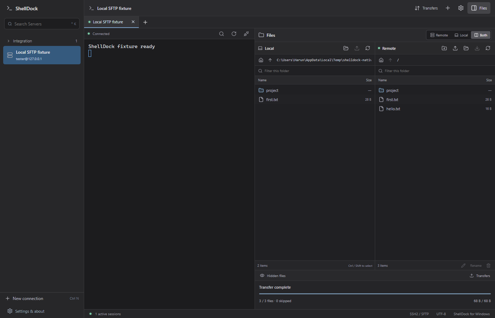

# Windows v0.2.0 doğrulaması — 17 Kasım 2026

## Geçen kontroller

| Kontrol | Sonuç |
|---|---|
| TypeScript / Vite üretim derlemesi | Geçti |
| Rust testleri | 8 geçti |
| Chromium arayüz testleri | 7 geçti |
| Clippy `--all-targets -- -D warnings` | Geçti |
| Rustfmt / Prettier | Geçti |
| Üretim kimlikli gerçek `.exe`: WebView2, IPC, yerel dosya listesi, bağlantı formu | Geçti |
| Yalıtılmış profilli gerçek `.exe`: çoklu yükleme, iç sürükleme, klasör indirme, dosya içerikleri | Geçti |
| Windows x64 NSIS paketi | Üretildi |

Rust testleri parola/anahtar/host güveni ve Windows credential deposuna ek olarak yerel dizin sıralaması, güvenli dosya adları, çok köklü transfer, iç içe ve boş klasörler, Skip/Replace, iptal temizliği ve sunucu rename hatasında eski dosyayı geri almayı kapsar. Test sunucusu yalnızca loopback'te çalışır; dosyaları bellektedir.

Arayüz testleri Remote/Local/Both, Ctrl çoklu seçimi, bırakılan çoklu yolun imleç altındaki uzak klasöre gönderilmesi, yerel panelden grup sürükleme, görünür yerel klasöre toplu indirme ve sekme değişiminde kuyruğun korunmasını doğrular.

## Gerçek Windows dosya akışı

`scripts/smoke-files.cjs`, yalnızca `com.harunbulbul.shelldock.smoke.<rastgele kimlik>` profiliyle derlenmiş uygulamayı kabul eder. Üretim profiline test sunucusu veya host anahtarı yazmayı reddeder. Test profilleri ve yerel fixture dosyaları kapatıldıktan sonra temizlenir; parola kaydetme kullanılmaz.

Test gerçek WebView2, gerçek Rust komutları ve gerçek SSH/SFTP bağlantılarıyla şu sırayı çalıştırır:

1. Geçici sunucu kaydı oluşturur, host güven diyaloğunu ve parola girişini tamamlar.
2. Native Tauri drop köprüsüne bir dosya ve iç içe klasörün gerçek yerel yollarını gönderir.
3. Yerel panelden başka bir dosyayı uzak klasöre DOM sürüklemesiyle yükler.
4. Uzak dosya/klasör grubunu görünür yerel klasöre indirir.
5. Unicode metin dahil indirilen tüm içerikleri kaynaklarla karşılaştırır; transfer özetini kontrol eder.

Bu, fiziksel Explorer fare/OLE hareketini otomatik sürüklemekle aynı test değildir. Windows olay dinleyicisi ve aynı payload üzerinden devam eden uygulama akışı doğrulanmıştır; farklı Windows ölçekleri ve fiziksel Explorer hareketi ayrıca elle denenmelidir.



## Üretim çıktıları

| Dosya | Boyut | SHA-256 |
|---|---|---|
| `src-tauri/target/release/shelldock.exe` | 13,590,528 byte | `D37F4B16CC70264D38E864EDACAEBBE03406B61B1A147814FFBBF1CC68C3605C` |
| `src-tauri/target/release/bundle/nsis/ShellDock_0.2.0_x64-setup.exe` | 3,476,582 byte | `77DC9D92B6B77A1DBCBA5B2F9D436CD40DB1D4E2956271FB0B6B1F542F7B7F18` |

Kod imzası yoktur. Kurulum/kaldırma sihirbazı henüz uçtan uca test edilmedi. Kaynakla yeniden derlemede hash değişebilir; yayımlanan paketin doğrulaması için Release'teki SHA256SUMS.txt kullanılmalıdır. Test profilli binary yayımlanmaz; üretim binary'sinin identifier değeri açılış testinde ayrıca kontrol edilir.

Kuyruk oturum belleğindedir. Kalıcı devam, pause/resume, senkronizasyon, dışa sürükleme, büyük dosya/disk doluluğu ve bağlantı kesintisi testleri bu sürümün doğrulama kapsamında değildir. Kaynak uygulamayla tam özellik eşitliği iddiası yoktur; [özellik planı](PARITY.md) güncel durumu listeler.

## Testleri tekrar çalıştırma

```powershell
npm.cmd run build
npm.cmd run test:rust
npm.cmd test
node scripts/run-cargo.cjs clippy --manifest-path src-tauri/Cargo.toml --all-targets -- -D warnings
npm.cmd run tauri build
npm.cmd run test:desktop
```

Yalıtılmış native dosya testi için benzersiz identifier ile ek derleme gerekir; [Windows CI adımı](../.github/workflows/windows.yml) çalıştırma örneğini içerir. Bu test derlemesi normal release binary yolunu geçici olarak değiştirir; dağıtımdan önce normal `npm run tauri build` tekrar çalıştırılmalıdır.
